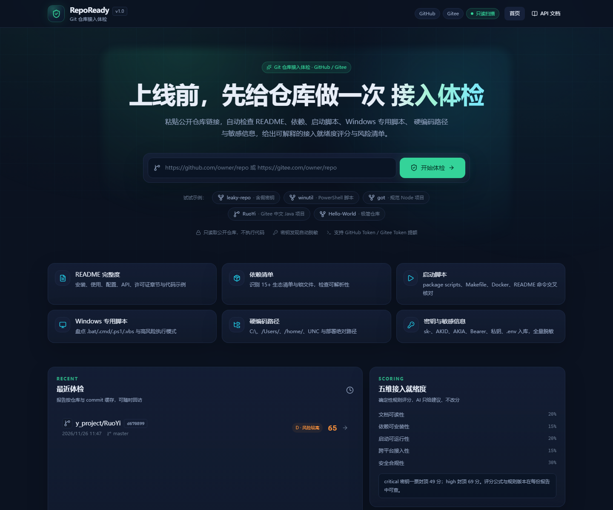
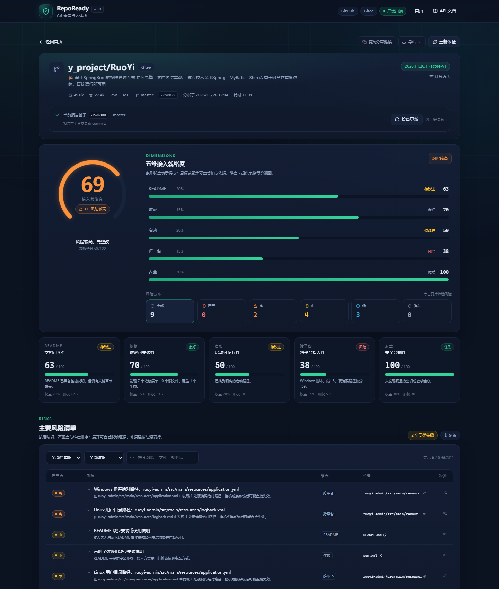

# RepoReady · Git 仓库接入体检

> 输入一个公开 GitHub / Gitee 仓库链接，自动完成接入前体检：README、依赖清单、启动脚本、Windows 专用脚本、硬编码路径、密钥与敏感信息，输出可解释的接入就绪度评分、五维可视化与按优先级排序的风险清单。





---

## 为什么做这个

接手一个开源仓库或外部项目时，真正费时间的通常不是读代码，而是这些“接入前问题”：

- README 有没有说清楚怎么安装、怎么启动？
- 依赖清单、锁文件是否完整，换台机器能不能装回来？
- 启动命令在哪里？是否只在某个 Windows 脚本里？
- 源码 / 配置里有没有 `C:\Users\...`、`/home/...` 这类换机即失效的绝对路径？
- 有没有把 `.env`、API Key、私钥提交进仓库？
- 上游后续更新了，怎么知道这次报告是不是还基于旧 commit？

RepoReady 把这些检查自动化，并用**确定性规则评分**给出可复现的接入就绪度结论。AI 是可选增强：只给建议和独立参考分，**不参与主评分**。

---

## 功能一览

| 能力 | 说明 |
|---|---|
| README 完整度 | 安装、使用、配置、API/架构、许可证章节；代码块、徽章、模板占位文本 |
| 依赖清单 | 15+ 生态清单与锁文件；`package.json` / `pyproject.toml` / `requirements.txt` / `go.mod` / `pom.xml` 等解析 |
| 启动路径 | `package.json scripts`、Makefile、Dockerfile/Compose、Procfile、pyproject scripts、`.sh`/`.bat` 启动脚本、README 命令交叉核对 |
| Windows 专用脚本 | `.bat` / `.cmd` / `.ps1` / `.vbs` 盘点；用途、README 引用、执行策略绕过、下载执行、提权等风险标记 |
| 硬编码路径 | Windows 盘符、UNC、macOS/Linux 用户目录、`/root`、`/mnt`、部署绝对路径；URL 与占位符排除 |
| 密钥与敏感信息 | `sk-`、`AKID`、`LTAI`、`AKIA`、`Bearer`、JWT、私钥、`.env` 入库、npm/docker 凭据；熵校验与占位符白名单 |
| 接入就绪度 | 五维加权 100 分制 + 等级 A–F；critical/high 密钥红线封顶；公式可查 |
| 风险清单 | 严重度、维度、文件行号、脱敏证据、修复建议、源码链接；筛选 / 搜索 / 展开 |
| 更新跟踪 | 报告绑定 commit；同 commit 秒回缓存；「检查更新」；README 另附生产级增量设计 |
| 报告导出 | JSON / Markdown；密钥始终脱敏 |
| AI 加分项 | Anthropic / OpenAI 兼容双适配器；总结、阻断项、快速收益、接入步骤、独立参考分；失败不影响报告 |

**支持平台**：GitHub（codeload 归档 + REST API）、Gitee（归档 / Git 浅克隆 + API v5）。仅支持**公开仓库**，私有仓库会被主动拒绝。

---

## 快速开始

### 环境要求

- Python **3.11+**（推荐 3.12）
- Node.js **20.19+**（推荐 22 LTS）
- Git（仅 Gitee 归档失败时的兜底克隆使用；GitHub 不需要）
- 无需 Docker、数据库或外部服务

### Windows 一键启动

```bat
start.bat
```

脚本会自动：

1. 找到 `py -3.12` / `py -3` / `python`；
2. 创建 `.venv` 并安装后端依赖（官方 PyPI 失败时自动切换清华镜像）；
3. 安装前端依赖并构建（仅在 dist 不存在或源码更新时）；
4. 选择一个空闲端口（默认 8000）启动 FastAPI；
5. 轮询 `/api/health` 成功后自动打开浏览器。

首次运行需要下载依赖，耐心等待即可。之后启动只需几秒。

### macOS / Linux

```bash
chmod +x start.sh
./start.sh
```

### 手动启动（开发）

```bash
# 后端
py -3.12 -m venv .venv
.venv/Scripts/python -m pip install -r backend/requirements.txt -r backend/requirements-dev.txt
.venv/Scripts/python -m uvicorn backend.app.main:app --reload --port 8000

# 前端（另一个终端）
cd frontend
npm install
npm run dev
```

- 生产模式：FastAPI 托管 `frontend/dist`，访问 `http://127.0.0.1:8000`
- 开发模式：Vite 访问 `http://127.0.0.1:5173`，`/api` 代理到 8000
- 也可以直接运行 `python scripts/dev.py` 同时启动两个开发进程

### 可选配置

首次启动会从 `.env.example` 复制出 `.env`（不会提交 Git）。所有变量都是可选的：

| 变量 | 默认 | 作用 |
|---|---|---|
| `GITHUB_TOKEN` | 空 | 提高 GitHub API 限额（未认证 60 次/小时/IP） |
| `GITEE_TOKEN` | 空 | 降低 Gitee API 限流风险 |
| `AI_PROVIDER` | `auto` | `auto` / `anthropic` / `openai` / `off` |
| `AI_ENABLED` | `true` | 强制关闭 AI 时设为 `false` |
| `ANTHROPIC_API_KEY` | 空 | Anthropic Claude Key |
| `ANTHROPIC_MODEL` | `claude-opus-5-5` | Claude 模型 |
| `OPENAI_API_KEY` | 空 | OpenAI 兼容接口 Key |
| `OPENAI_BASE_URL` | `https://api.openai.com/v1` | 兼容 DeepSeek / Qwen / OpenAI |
| `OPENAI_MODEL` | 空 | 例如 `deepseek-chat`、`qwen-plus` |
| `AI_TIMEOUT_SECONDS` | `30` | AI 请求超时 |
| `MAX_ARCHIVE_MB` | `50` | 压缩归档上限 |
| `MAX_EXTRACTED_MB` | `200` | 解压后总量上限 |
| `MAX_FILES` | `5000` | 最多分析文件数 |
| `SCAN_CONCURRENCY` | `2` | 同时扫描数 |

**AI 选择逻辑**：`auto` 优先 Anthropic，其次 OpenAI 兼容；都没有则关闭。没有 Key 时报告与规则建议完全可用，AI 区会显示配置指引。

---

## 评分体系

### 五维权重

| 维度 | 权重 | 检查内容 |
|---|---:|---|
| 文档可读性（README） | 20 | 存在性、长度、安装/使用/配置/API/许可证、代码示例、模板占位 |
| 依赖可安装性 | 15 | 清单、锁文件、可解析性、多生态、README 安装说明 |
| 启动可运行性 | 20 | 启动脚本、文档命令、构建步骤、容器/Procfile、快速开始 |
| 跨平台接入性 | 15 | Windows 专用脚本、硬编码绝对路径；注释/文档/测试降级 |
| 安全合规性 | 30 | 高置信 Token、私钥、`.env` 入库、泛化凭据（熵+占位符过滤） |

```
total = round( Σ(dimension_score × weight) / 100 )
```

- 五个维度始终参与计算，不做 N/A 重归一；无源码 / 无清单 / 无启动方式会在对应维度得 0 分。
- 等级：**A ≥ 90**、**B 80–89**、**C 70–79**、**D 60–69**、**F < 60**。
- **红线封顶**：存在 critical 级密钥/私钥 → 总分 ≤ **49（F）**；存在 high 级敏感信息 → 总分 ≤ **69（D）**。
- 每个维度返回得分原因（加分/扣分项、命中规则），报告内「评分方法」可查看公式、权重、等级、封顶规则与规则版本。
- 同一快照 + 同一规则版本重复扫描，总分与指纹完全一致。报告包含 `fingerprint`（不含 AI 与时间），AI 成功/失败不会改变评分或指纹。

### 风险等级

| 等级 | 典型场景 |
|---|---|
| critical | 私钥、云厂商 AccessKey、OpenAI/Anthropic Key、含真实值的 `.env` 入库 |
| high | GitHub/GitLab Token、Bearer、泛化高熵凭据；源码/配置中的绝对路径；代码项目无启动方式 |
| medium | 泛化中置信凭据、JWT；Windows-only 启动；注释中的路径；缺少安装说明 |
| low | 文档/测试中的路径、缺少锁文件、README 偏薄、低置信信号 |
| info | 仓库画像、扫描限制等信息 |

风险按“阻断项 → 严重度 → 维度 → 文件/行”排序；每条包含脱敏证据、修复建议、规则 ID、置信度与源码行链接。

---

## 更新跟踪设计

> 题目要求的“更新跟踪”以设计说明为主。本仓库实现了**轻量版**（报告级 commit 缓存 + 检查更新），并在本节说明生产级增量方案。

### 1. 怎么发现更新

**已实现**

- 报告固定记录 `commit.sha / short_sha / branch / message / date`。
- 报告页「检查更新」调用 `GET /api/reports/{id}/updates`：服务端只请求平台 API 的分支 HEAD，与报告 commit 比较。
- HEAD 检查结果在服务端内存缓存 `5 分钟`，避免反复刷新反复打 API。
- 首页「最近体检」展示历史报告及其 commit，可直接回访。

**生产级设计**

- 定时任务（cron / 队列）批量检查关注仓库的 `pushed_at` 或分支 HEAD；命中更新后入队重新体检。
- 可接 GitHub push webhook / Gitee webhook，实现近实时触发。
- 报告列表展示“上次检查时间 / 数据新鲜度”，避免用户误以为永远最新。

### 2. 怎么避免全量重算

**已实现（轻量）**

- 报告 ID 由 `平台 + 仓库 + 分支 + commit + 规则版本 + schema 版本` 确定性生成。
- 扫描前先取 HEAD；若同 commit 的报告已存在且规则版本一致 → 直接返回缓存（`cached=true`），毫秒级。
- 规则版本变化或手动「重新体检」才重新计算；重新计算按 commit 覆盖同一份报告 ID。
- 相同仓库 + 分支的并发扫描会复用进行中的任务，避免重复下载。

**生产级设计（不在本仓库实现）**

1. 使用 GitHub Trees/Compare API（Gitee 对应 compare 接口）拿到旧 commit → 新 commit 的变更文件列表与 blob SHA。
2. 以 `blob_sha + rules_version` 为键缓存**文件级检测结果**：
   - 仅对新增 / 修改文件运行路径、密钥、脚本等内容检测；
   - 未变文件复用旧 findings；
   - 删除文件剔除其 findings；
   - README、依赖清单、启动路径等聚合类分析基于缓存结果重新汇总。
3. 出现以下情况回退全量扫描：force push、compare 结果被截断、API 不提供对比、规则版本变化、缓存损坏。
4. 仓库元数据与目录结构可复用；评分与风险清单在新 commit 上重新汇总。
5. 报告标注 `analyzed_commit`、`tool_version`、`rules_version`，并提供「基于新 commit 重新生成」入口。

### 3. 报告如何标注 commit

- UI 顶部显示分支 + short SHA + 源码链接，分析时间与耗时。
- JSON / Markdown 导出都包含完整 commit SHA、短 SHA、分支、分析时间、规则版本、评分指纹。
- 所有源码行链接都固定在 `blob/{commit_sha}/...`，不会随分支移动。
- 重新体检生成新报告时，若上一份报告存在，会记录 `previous_commit` / `previous_report_id`，报告页展示前后 commit 对比。
- Gitee 归档被 WAF 拦截时使用浅克隆；若克隆到的 SHA 与元数据 HEAD 不一致，报告会标记 `snapshot_warning`，明确告知快照一致性风险，而不是假装精确。

### 4. 失败或限流时怎么兜底

- **Token 提额**：支持 `GITHUB_TOKEN` / `GITEE_TOKEN`，未配置时只使用 1–2 次元数据请求，并给出明确限流提示与重置时间。
- **HEAD 检查失败**：返回 `unknown`，前端展示“无法确认是否有更新，展示缓存报告”，**绝不**用旧数据冒充最新。
- **GitHub**：元数据 API 可能 403/429；归档走 `codeload`（不占 API 配额）并按 SHA 固定快照；`git ls-remote` 在本环境不可靠，因此不作为 GitHub 主链路。
- **Gitee**：归档接口可能 HEAD 405 或被反爬返回 HTML；检测到 HTML 后自动回退 `git clone --depth 1`，并标注快照来源；Gitee HEAD API 失败时可用 `git ls-remote` 兜底。
- **网络错误**：API / 归档请求有超时、指数退避和重试；归档有 50MB 压缩 / 200MB 解压 / 5000 文件上限。
- **缓存损坏**：报告 JSON 校验失败会重命名为 `.corrupt` 并按未命中处理；索引缺失时从报告文件重建。
- **AI 失败**：只影响 AI 面板（可重试），不影响确定性报告、风险清单与导出。

---

## AI 加分项

- **双适配器**：Anthropic 官方 SDK + OpenAI 兼容接口（DeepSeek / Qwen / OpenAI 等）。
- **只发脱敏摘要**：仓库元数据、五维分数、Top 风险、README 章节/标题、依赖与启动信号；不发送源码全文与明文密钥。
- **结构化输出校验**：Pydantic 校验，参考分 clamp 到 0–100，字符串与数组截断；非法字段归一化。
- **独立参考分**：UI 明确标注“AI 参考分（不影响主评分）”；主评分与指纹在 AI 前后完全一致（有测试覆盖）。
- **失败降级**：未配置 / 超时 / 限流 / 结构错误 → 显示中文提示与重试按钮；规则建议始终可用。
- **隐私**：AI 请求前再次执行高置信密钥自检；命中则拒绝发送。

> AI 只解释和排序建议，**不会修改风险事实或主评分**。

---

## API

| 方法 | 路径 | 说明 |
|---|---|---|
| `POST` | `/api/scans` | `{url, branch?, force?}` → `{job_id, status}` |
| `GET` | `/api/scans/{job_id}` | 扫描进度（stage / progress / message / report_id） |
| `GET` | `/api/reports/{report_id}` | 完整报告 JSON |
| `GET` | `/api/reports?limit=10` | 最近报告摘要 |
| `POST` | `/api/reports/{report_id}/refresh` | 基于当前仓库重新扫描（强制刷新） |
| `GET` | `/api/reports/{report_id}/updates` | 检查上游分支 HEAD |
| `POST` | `/api/reports/{report_id}/ai` | 生成/重试 AI 建议（幂等，已有结果直接返回） |
| `GET` | `/api/reports/{report_id}/export?format=json\|md` | 下载报告 |
| `GET` | `/api/health` | 版本、规则版本、AI / Token 配置状态（布尔） |
| `GET` | `/api/examples` | 示例仓库与演示点 |
| `GET` | `/api/docs` | Swagger UI |

错误响应统一为：

```json
{ "error_code": "RATE_LIMITED", "message": "GitHub API 触发限流…", "retry_after": 120 }
```

---

## 安全与隐私

- **只读**：只下载归档并静态扫描；绝不执行仓库代码、安装仓库依赖、运行仓库脚本。
- **SSRF 防护**：仅允许 `github.com` / `gitee.com`；固定 API 与归档 host；重定向逐跳校验；拒绝 IP、非标准端口、userinfo。
- **私有仓库**：即使 Token 能访问，也会主动拒绝，避免把私有代码送入分析 / AI。
- **归档安全**：只接受普通文件；拒绝绝对路径、`..`、盘符路径、符号链接 / 硬链接 / 设备文件；处理 Windows 保留名、大小写冲突、加密条目；强制压缩 / 解压体积与文件数上限。
- **密钥处理**：只在内存匹配；报告、缓存、导出、AI 请求只含脱敏值；日志不打印源码或明文凭据；`test_secrets.py` 断言序列化报告不含原始假密钥。
- **AI 隐私**：只发送脱敏摘要；发送前自检；UI 明示。
- **限流**：扫描接口 30 次/分钟/IP；AI 10 次/分钟；扫描并发 ≤ 2；大仓库拒绝或截断。
- **缓存位置**：`data/`（已 gitignore），仅存脱敏报告与索引；临时解压目录扫描结束即删除。

---

## 测试

```bash
# 后端
.venv/Scripts/python -m pytest

# 前端
cd frontend
npm run typecheck
npm run build
```

当前状态：**107 个后端测试全部通过**，覆盖：

- URL 解析与 SSRF / 路径穿越拒绝；
- README / 依赖 / 启动 / Windows / 路径 / 密钥六类检测与误报回归；
- `.env` 入库、`.gitignore` 覆盖、私钥、Bearer、JWT、各云厂商 Key；
- 归档路径穿越、symlink、zip bomb、文件数上限、Windows 保留名 / 大小写冲突；
- 评分权重、封顶、指纹稳定性；
- 报告缓存 / 索引 / 历史 / 损坏隔离；
- API 健康检查、扫描提交、报告、导出、SPA fallback、错误码；
- AI 成功 / 失败 / 禁用 / 参考分 clamp / 不改变主评分与指纹。

### 真实仓库冒烟

| 仓库 | 验证点 |
|---|---|
| `github.com/Plazmaz/leaky-repo` | 密钥识别、脱敏、封顶、风险排序 |
| `github.com/ChrisTitusTech/winutil` | PowerShell 脚本盘点、Windows 风险 |
| `github.com/sindresorhus/got` | 规范 Node 项目高分样本 |
| `gitee.com/y_project/RuoYi` | Gitee 全链路、Java 依赖、`ry.sh`/`ry.bat`、浅克隆兜底 |
| `github.com/octocat/Hello-World` | 极简仓库低分与缺失项 |

> 仓库内容会变化，真实分数仅用于演示；单测断言只针对固定 fixture。

---

## 目录结构

```text
backend/
  app/
    main.py                 # FastAPI app / SPA 托管 / 异常处理
    config.py               # 环境变量、限制、版本
    models.py               # Pydantic 报告/API 模型
    api/routes.py           # 扫描、报告、更新、导出、AI API
    services/
      platform/             # URL 解析 + GitHub/Gitee 适配器
      fetcher.py            # 流式下载、安全解压、Git 克隆兜底
      file_index.py         # 文件索引、忽略规则、项目画像
      analyzers/            # README / 依赖 / 启动 / Windows / 路径 / 密钥
      scoring.py            # 权重、封顶、等级、指纹
      scan_service.py       # 扫描编排、缓存、报告组装
      scan_manager.py       # 线程池 job、进度、去重
      report_store.py       # 原子 JSON 报告 + 索引
      ai/                   # Anthropic / OpenAI 兼容 + prompt + 校验
      export.py             # Markdown 导出
    utils/                  # 文本、文件、脱敏模式
  tests/                    # pytest + 固定 fixture
frontend/
  src/
    pages/                  # 首页 / 扫描进度 / 报告 / 404
    components/             # 评分环、维度条、风险表、面板、AI 面板
    lib/                    # API client、类型、格式化
scripts/
  start.py                  # 跨平台一键启动
  dev.py                    # 双进程开发模式
docs/
  PRD.md                    # 产品需求与设计
  screenshots/              # README 截图
```

---

## 已知限制

- 所有检测均为**启发式静态规则**，无法理解业务语境；密钥与泛化凭据命中需人工确认，但建议按“可能泄露”处理。
- 仅支持公开仓库；不支持私有仓库、GitLab、Bitbucket。
- 不执行仓库代码，不做依赖漏洞库比对、许可证合规审计或完整 SAST。
- 归档体积 / 文件数 / 文本扫描量有上限，超限会截断并在报告中标明。
- URL 中的分支只取 `/tree/` 后第一段；带 `/` 的复杂分支请用默认分支或 API 参数（当前 UI 未暴露分支选择）。
- Gitee 归档接口可能被 WAF 拦截，会自动回退 `git clone --depth 1`；克隆期间分支移动会触发 `snapshot_warning`。
- **文件级增量扫描是设计说明，未在本实现中启用**；当前缓存粒度是“仓库 + 分支 + commit 的整份报告”。

---

## 提交与发布

本仓库内已按阶段完成本地 Git 提交。发布到你自己的 GitHub：

```bash
# 先在 GitHub 网页端创建空仓库（不要勾选初始化 README）
git remote add origin https://github.com/<your-name>/<repo-name>.git
git branch -M main
git push -u origin main
```

CI 会在 push / PR 时运行：

- 后端：`pytest`
- 前端：`npm ci` + `tsc --noEmit` + `vite build`

---

## AI 使用说明

开发过程中使用了 Claude Code 辅助需求拆解、架构、编码、测试与文档；所有 AI 输出均经过单元测试、真实仓库冒烟、构建和人工复核。详见 [AI_USAGE.md](AI_USAGE.md)，其中包含真实发生的 AI 错误、发现方式与修正。

## License

MIT
